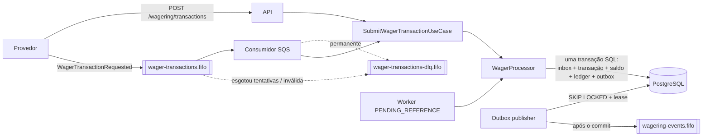

# ARCHITECTURE.md

Decisões técnicas, trade-offs e limitações do Distributed Wagering Processor.

## Sumário

1. [Visão geral](#1-visão-geral)
2. [Camadas e fronteiras](#2-camadas-e-fronteiras)
3. [ORM, mapeamento do Money e estratégia transacional](#3-orm-mapeamento-do-money-e-estratégia-transacional)
4. [Money](#4-money)
5. [Concorrência](#5-concorrência)
6. [Idempotência](#6-idempotência)
7. [Garantias no schema do banco](#7-garantias-no-schema-do-banco)
8. [Máquina de estados da transação](#8-máquina-de-estados-da-transação)
9. [Regras de negócio e interpretações adotadas](#9-regras-de-negócio-e-interpretações-adotadas)
10. [Referências fora de ordem](#10-referências-fora-de-ordem)
11. [Códigos de falha](#11-códigos-de-falha)
12. [Mapeamento de status HTTP](#12-mapeamento-de-status-http)
13. [Consumo SQS](#13-consumo-sqs)
14. [Transactional outbox](#14-transactional-outbox)
15. [Observabilidade](#15-observabilidade)
16. [Autenticação](#16-autenticação)
17. [Estratégia de testes](#17-estratégia-de-testes)
18. [Trade-offs e limitações](#18-trade-offs-e-limitações)
19. [O que não foi implementado](#19-o-que-não-foi-implementado)

---

## 1. Visão geral

Um único serviço NestJS, executado em várias instâncias idênticas. Cada instância tem quatro papéis, todos ligáveis por variável de ambiente:

- **API HTTP** (wallets, submissão, consultas, reconciliação, health, métricas);
- **consumidor SQS** de `wager-transactions.fifo`;
- **publisher do outbox** para `wagering-events.fifo`;
- **worker de referências pendentes** (`PENDING_REFERENCE`).



O PostgreSQL é a fonte da verdade de todas as invariantes. O SQS, inclusive o FIFO, é tratado como otimização de ordem e deduplicação, nunca como garantia.

## 2. Camadas e fronteiras

```text
src/
  domain/          regras puras: Money, Wallet, WagerTransaction, WalletLedgerEntry,
                   InboxMessage, OutboxMessage, eventos, WagerSettlement
  application/     casos de uso e portas (UnitOfWork, repositórios, Clock, Instrumentation)
  infrastructure/  MikroORM, SQS, pino, Prometheus, workers, config
  presentation/    controllers HTTP, contratos (zod), filtro de erros, consumidor SQS, auth
```

- A dependência aponta para dentro. O domínio não importa NestJS, MikroORM, AWS SDK nem pino.
- A aplicação depende só de portas (`application/ports.ts`, `application/instrumentation.ts`).
- Todas as classes de domínio têm construtor `private` e factories estáticas (`create`, `open`, `from`, `enqueue`, `receive`, `rehydrate`). `rehydrate` reconstrói estado persistido sem revalidar transições.
- O consumidor SQS e o controller HTTP chamam o **mesmo** `SubmitWagerTransactionUseCase`. A única diferença é que a fila passa um `inbox` no contexto.
- As regras da seção 7 do desafio estão concentradas em `WagerSettlement` (serviço de domínio puro, testado sem banco). `WagerProcessor` (aplicação) usa essas regras e persiste o resultado. Ele é compartilhado entre a submissão e o worker de referências.

## 3. ORM, mapeamento do Money e estratégia transacional

**MikroORM 6** (opção preferencial do desafio). Ele roda no Bun 1.4 sem adaptação (MikroORM 7 exige Node 22.17+ e foi evitado por isso).

**Mapeamento:** as entidades do ORM são **registros de persistência** separados das classes de domínio (`infrastructure/persistence/records.ts`, via `EntitySchema`, sem decorators). Os mappers (`mappers.ts`) convertem registro em domínio sempre por `rehydrate`. Assim o domínio fica livre de tipos e decorators do ORM, e a regra "reidratação usa `rehydrate`" vale de verdade, não por convenção.

**Money na persistência:** duas colunas, `amount numeric(20,2)` e `currency char(3)`. A propriedade é mapeada como `decimal`, que o driver `pg` entrega como **string**. A string vai direto para `Money.fromPersisted`. Em nenhum ponto o valor passa por `number`.

**Estratégia transacional:**

- `MikroOrmUnitOfWork.run()` usa `em.fork().transactional()`: cada unidade de trabalho tem um `EntityManager` e um identity map próprios.
- A trava da wallet usa `LockMode.PESSIMISTIC_WRITE` (`SELECT ... FOR UPDATE`).
- `SET LOCAL lock_timeout` limita quanto tempo uma requisição espera por uma wallet quente (default 5 s).
- As escritas são **explícitas** (`em.insert`, `em.nativeUpdate`) em vez do flush implícito da Unit of Work. A ordem dos comandos importa para os triggers (a wallet é atualizada antes do lançamento), e o `UPDATE ... WHERE version = ?` fica visível no código em vez de escondido no ORM.
- Isolamento `READ COMMITTED` (padrão do PostgreSQL). A correção não depende de `SERIALIZABLE`: depende da trava da linha, das releituras feitas depois dela e das constraints.
- Erros do banco são traduzidos na fronteira da infraestrutura: violação de unique, deadlock, serialização e timeout de lock viram `ConcurrencyConflictError` (refaz a unidade inteira); falha de conexão vira `TransientInfrastructureError`.

## 4. Money

- Internamente o valor é um `bigint` em unidades mínimas (escala fixa 2). Aritmética inteira é exata, então **não existe arredondamento** em nenhuma operação. O esqueleto do desafio cita `Decimal`; com escala fixa, `bigint` dá a mesma exatidão sem dependência externa.
- Entrada (`Money.from`) aceita só `^(0|[1-9]\d{0,17})(\.\d{1,2})?$`: rejeita NaN, Infinity, notação científica, string vazia, sinal, vírgula, zeros à esquerda, mais de 2 casas e valores acima de `numeric(20,2)`. `amount` precisa ser string; `number` é rejeitado já no contrato.
- Valores com menos casas (`"25"`, `"25.5"`) são aceitos e normalizados para 2 casas (`"25.00"`, `"25.50"`). A saída é sempre com 2 casas.
- Operações entre moedas diferentes lançam `CurrencyMismatchError`.
- O modelo é multi-moeda (uma wallet por player e moeda). Os testes usam BRL e USD para provar o conflito de moeda.

## 5. Concorrência

**Unidade de concorrência: a linha da wallet.** Não existe lock global.

Estratégia combinada, em camadas:

1. **Lock pessimista por wallet** (`SELECT ... FOR UPDATE` na linha da wallet). Operações da mesma wallet são serializadas; wallets diferentes andam em paralelo.
2. **UPDATE condicionado à versão** (`UPDATE wallets ... WHERE id = ? AND version = ?`). Redundante com o lock, mas se algum caminho futuro esquecer o lock, o lost update vira erro em vez de corromper o saldo.
3. **Constraints e triggers no banco** (seção 7): mesmo com bug na aplicação, saldo negativo, lançamento desbalanceado e saldo sem lançamento são recusados.
4. **Retry limitado** (até 5 tentativas, backoff curto com jitter) para conflitos de concorrência. Cada tentativa refaz a transação inteira, com leituras novas.

**Por que pessimista e não só otimista:** o cenário típico de iGaming é a *hot wallet* (um jogador fazendo muitas apostas por segundo, provedores reenviando). Com lock otimista puro, N requisições concorrentes leem a mesma versão, uma vence e N-1 refazem, o que gera tempestade de retries e latência imprevisível. Com o lock da linha, elas entram em fila no próprio PostgreSQL, cada uma é feita uma vez e o tempo de espera é limitado por `lock_timeout`. O custo é segurar uma conexão enquanto espera, o que o `lock_timeout` e o pool limitam.

**Ordem dos locks:** sempre e só a linha da wallet. A referência de um REFUND/ROLLBACK é lida sem lock: ela é da mesma wallet (verificado) e uma transação terminal é imutável (garantido por trigger). Não há dois locks de linha na mesma transação, então não há deadlock entre wallets.

**Cenário obrigatório** (saldo 100, duas apostas de 80): a segunda requisição espera o lock, relê a wallet já com saldo 20 e é rejeitada com `INSUFFICIENT_FUNDS`. Coberto em `test/concurrency.int.test.ts`, inclusive com 3 processos.

## 6. Idempotência

- O header `Idempotency-Key` é obrigatório e é a fonte da verdade. Pela fila, a chave vem em `data.idempotencyKey`.
- `payloadHash = hex(SHA-256(UTF-8(JSON canônico)))` do subconjunto de negócio: `providerId`, `externalTransactionId`, `playerId`, `walletId`, `roundId`, `gameId`, `kind`, `money.amount` (normalizado para 2 casas), `money.currency` e `referenceExternalTransactionId` (omitido se ausente). JSON canônico: chaves ordenadas em todos os níveis, sem espaços, `undefined` omitido. Header, `messageId`, `occurredAt` e metadados de transporte ficam de fora.
- A deduplicação é **persistente**: unique em `idempotency_key` e em `(provider_id, external_transaction_id)`. Não existe cache em memória.
- Mesma chave e mesmo hash: **replay**, devolve o resultado gravado (`transactionId`, `status`, `failureCode`, `balance` observado naquele momento) com `idempotentReplay: true`.
- Mesma chave e hash diferente: **409 `IDEMPOTENCY_KEY_CONFLICT`**, nunca replay.
- Mesmo `(providerId, externalTransactionId)` com outra chave: **409 `EXTERNAL_TRANSACTION_CONFLICT`**.

**Corrida entre duplicatas:** a busca pela chave é feita antes e **de novo depois** do lock da wallet. Quem esperava o lock vê o commit de quem passou antes e devolve replay. Se duas requisições com a mesma chave apontarem para wallets diferentes (payload diferente), ambas tentam inserir e a unique do banco barra uma. O `ConcurrencyConflictError` faz a unidade ser refeita, e na segunda volta a busca encontra o registro e responde conflito. A decisão replay/conflito é tomada sobre o registro encontrado, não sobre qual consulta o encontrou: em `READ COMMITTED` dois SELECTs seguidos podem ver snapshots diferentes (essa corrida foi encontrada pelo teste de 50 envios paralelos e corrigida).

**Inbox (fila):** `INSERT ... ON CONFLICT (consumer_name, message_id) DO NOTHING` na mesma transação do processamento. Se a mesma mensagem chega em paralelo, a segunda inserção espera o commit da primeira e então não insere nada: é duplicata, e o consumidor faz ack devolvendo o resultado original.

## 7. Garantias no schema do banco

Tudo em `src/infrastructure/persistence/migrations/` (migration reversível, `up` e `down`). Testado em SQL puro em `test/schema.int.test.ts`.

| Garantia | Como |
|---|---|
| Saldo nunca negativo | `CHECK (balance >= 0)` em wallets; `CHECK (balance_before >= 0 AND balance_after >= 0)` no ledger |
| Uma wallet por player e moeda | `UNIQUE (player_id, currency)` |
| Version só muda com o saldo, sempre +1 | trigger `wallets_guard_update` |
| Player, moeda e criação da wallet imutáveis; sem DELETE | trigger |
| Toda mudança de saldo tem lançamento | **constraint trigger `DEFERRABLE INITIALLY DEFERRED`**: no commit, exige um lançamento com `wallet_version = version` e `balance_after = balance` |
| Todo lançamento descreve o estado da wallet | trigger `BEFORE INSERT`: `balance_after` e `wallet_version` iguais aos da wallet |
| Lançamento balanceado | `CHECK` before ± amount = after, `amount > 0` |
| Ledger append-only | triggers bloqueiam UPDATE, DELETE e TRUNCATE |
| No máximo um lançamento por transação e wallet | `UNIQUE (wallet_id, transaction_id)` |
| Cadeia de versões sem duplicata | `UNIQUE (wallet_id, wallet_version)` |
| Idempotência | `UNIQUE (idempotency_key)`, `UNIQUE (provider_id, external_transaction_id)` |
| Reversão única | índice único parcial em `reference_transaction_id` onde `status = 'PROCESSED' AND kind IN ('REFUND','ROLLBACK')` |
| Uma OPENING por wallet | índice único parcial |
| Status terminal imutável; campos de negócio imutáveis; sem DELETE | trigger `wager_transactions_guard_update` |
| REFUND/ROLLBACK exigem referência; `failure_code` sse REJECTED/FAILED; pendente tem agendamento | `CHECK` |
| Inbox único | `PRIMARY KEY (consumer_name, message_id)` |
| Evento único no outbox | índice único em `payload->>'eventId'` |

Índices de apoio: pendentes vencidas (`next_reference_attempt_at` parcial), pendentes por referência (para acordá-las quando a referência chega), outbox vencido (`next_attempt_at` parcial onde `published_at IS NULL`).

## 8. Máquina de estados da transação

```text
PENDING ──────────► PROCESSED | REJECTED | FAILED | PENDING_REFERENCE
PENDING_REFERENCE ─► PROCESSED | REJECTED | FAILED | PENDING_REFERENCE (nova tentativa)
PROCESSED, REJECTED, FAILED: terminais
```

- `PENDING` existe só em memória: a transação nasce e é decidida na mesma transação SQL, então nunca é gravada como `PENDING`.
- Transicionar um estado terminal lança `InvalidTransactionStateError` (erro de programação). O banco também recusa.
- `FAILED` é usado quando o worker de referências encontra um erro permanente inesperado ao reprocessar uma pendente: a transação fica terminal e auditável com `INTERNAL_ERROR`. Na submissão (HTTP/SQS), falha de infraestrutura faz rollback e nada é gravado; o provedor recebe 503 (ou a mensagem volta para a fila).

## 9. Regras de negócio e interpretações adotadas

- **Reversão única por referência, independente do tipo.** A regra 4 do desafio diz "pelo mesmo tipo de operação". Interpretei de forma mais estrita: uma BET pode ser revertida **uma vez no total**, por REFUND **ou** ROLLBACK. Permitir os dois creditaria a mesma aposta duas vezes, o que viola "não duplicar créditos". Um ROLLBACK de um REFUND continua permitido (é outra referência). O índice único parcial garante isso no banco.
- **WIN e LOSS podem referenciar a BET** (opcional). Se referenciam, a referência passa pelas mesmas validações de escopo (provider, player, wallet, moeda, rodada) e entra em `PENDING_REFERENCE` se ainda não chegou.
- **LOSS aceita valor zero** (não move saldo). As demais operações exigem valor positivo.
- **Referência existente mas ainda pendente** (ex.: ROLLBACK de um REFUND que espera a própria BET): a transação também fica em `PENDING_REFERENCE`.
- **Referência REJECTED ou FAILED:** rejeição `REFERENCE_NOT_PROCESSED`.
- **Wallet inexistente** na submissão: 422 `WALLET_NOT_FOUND` **sem persistir** a transação, porque `wallet_id` é chave estrangeira e não há wallet a que associá-la. O resultado é determinístico, então reenviar dá a mesma resposta.
- **Player diferente do dono da wallet:** rejeição persistida `PLAYER_WALLET_MISMATCH`.
- **Replay de uma transação que estava pendente e já foi liquidada** devolve o estado atual (PROCESSED/REJECTED) e o saldo observado na liquidação.
- **OPENING** é gravada com `providerId = "internal"`, `externalTransactionId = "opening:{walletId}"` e não pode ser submetida (o contrato só aceita BET, WIN, LOSS, REFUND, ROLLBACK).

## 10. Referências fora de ordem

- A transação fica em `PENDING_REFERENCE` com `next_reference_attempt_at` e `reference_attempts`.
- O evento `WagerTransactionPendingReference` é publicado **uma vez**, quando ela entra em espera.
- Um worker agendado (todas as instâncias, sem coordenação) busca as vencidas, trava a wallet, **relê o status depois do lock** e reprocessa. Se outra instância já tratou, pula.
- **Backoff exponencial:** 2 s, 4 s, 8 s, ... limitado a 120 s, por **10 tentativas** (cerca de 8 minutos no total). Justificativa: referências fora de ordem normalmente chegam em segundos (reordenação da rede ou da fila); poucos minutos cobrem reprocessamentos de provedores sem deixar transações penduradas por horas. Tudo é configurável (`PENDING_REFERENCE_*`).
- **Atalho:** quando uma transação é processada, as pendentes que a referenciam têm `next_reference_attempt_at` antecipado para agora, então são reprocessadas no próximo ciclo do worker (100 ms a 1 s), sem esperar o backoff.
- Esgotadas as tentativas: `REJECTED` com `REFERENCE_NOT_FOUND` e evento `WagerTransactionRejected`.

## 11. Códigos de falha

| failureCode | Quando | O que o provedor deve fazer |
|---|---|---|
| `INSUFFICIENT_FUNDS` | BET maior que o saldo | Não reenviar a mesma aposta |
| `REVERSAL_INSUFFICIENT_FUNDS` | ROLLBACK (de WIN ou REFUND) deixaria saldo negativo | Operacional: o crédito revertido já foi gasto; tratar manualmente |
| `CURRENCY_MISMATCH` | Moeda da operação diferente da wallet | Corrigir o payload |
| `PLAYER_WALLET_MISMATCH` | Player não é dono da wallet | Corrigir o payload |
| `REFERENCE_NOT_FOUND` | Referência não chegou no prazo | Enviar a referência e depois a reversão com **novo** id externo |
| `REFERENCE_INVALID_KIND` | Ex.: REFUND de WIN, ROLLBACK de LOSS | Corrigir o payload |
| `REFERENCE_MISMATCH` | Referência de outro player, wallet, moeda ou rodada | Corrigir o payload |
| `REFERENCE_NOT_PROCESSED` | Referência terminou REJECTED/FAILED | Desistir: não há o que reverter |
| `REFERENCE_ALREADY_REVERSED` | Referência já revertida | Desistir: já foi feito |
| `REFERENCE_AMOUNT_MISMATCH` | Valor diferente da referência | Corrigir o payload |
| `INTERNAL_ERROR` | Status FAILED no reprocessamento | Contatar a operação |

Erros sem transação persistida usam `error.code`: `VALIDATION_ERROR`, `IDEMPOTENCY_KEY_CONFLICT`, `EXTERNAL_TRANSACTION_CONFLICT`, `WALLET_NOT_FOUND`, `WALLET_ALREADY_EXISTS`, `TRANSACTION_NOT_FOUND`, `INVALID_CURSOR`, `CONCURRENCY_CONFLICT`, `TRANSIENT_FAILURE`.

## 12. Mapeamento de status HTTP

O mesmo mapeamento vale em todos os endpoints (`presentation/http/http-errors.filter.ts`). O provedor decide se reenvia só pelo status:

| Status | Significado | Reenviar? |
|---|---|---|
| 201 | Transação nova processada / wallet criada | Não precisa |
| 200 | Replay idempotente de transação processada; consultas | Não precisa |
| 202 | Aceita, `PENDING_REFERENCE` | Não; consultar depois |
| 400 | Payload inválido (formato, Money, header ausente, JSON malformado) | Só depois de corrigir |
| 404 | Recurso da URL inexistente | Não |
| 409 | Conflito de idempotência / id externo / wallet duplicada | Não |
| 422 | Rejeição por regra de negócio (corpo traz `status: REJECTED` e `failureCode`) | Não |
| 503 | Falha transitória (banco fora, lock esgotado); header `Retry-After` | **Sim**, com a mesma chave |
| 500 | Erro inesperado / transação FAILED | Contatar a operação |

Replay de uma rejeição continua 422 (com `idempotentReplay: true`); replay de pendente continua 202.

## 13. Consumo SQS

- Laços de `ReceiveMessage` (long polling) com concorrência configurável por instância. Dentro de um lote, as mensagens são processadas em sequência.
- **Ack só depois do commit:** o `DeleteMessage` vem depois de `uow.run()` retornar. Se o processo morre entre os dois, a mensagem reaparece e o inbox a absorve (testado com injeção de falha real: o processo se mata com SIGKILL depois do commit).
- Classificação:

| Tipo | Exemplos | Ação |
|---|---|---|
| Sucesso / duplicata | PROCESSED, REJECTED, PENDING_REFERENCE, replay, inbox duplicado | ack |
| Negócio (terminal) | conflito de idempotência, wallet inexistente | ack + log + métrica |
| Transitório | banco fora, timeout de lock, conflito que esgotou o retry, erro inesperado | sem ack; `ChangeMessageVisibility` com backoff exponencial (2 s, 4 s, ... até 300 s) |
| Permanente | JSON malformado, contrato inválido, Money inválido, erro de domínio inesperado | envia para a DLQ com `failureReason` e remove |
| Tentativas esgotadas | `ApproximateReceiveCount >= SQS_MAX_ATTEMPTS` (5) e ainda transitório | DLQ com `failureReason = max-attempts` |

- A redrive policy da fila (`maxReceiveCount` 6) é rede de segurança caso o próprio consumidor não consiga mover a mensagem.
- **SIGTERM:** `enableShutdownHooks` dispara `beforeApplicationShutdown`. O consumidor para de buscar, termina a mensagem em andamento e devolve as não iniciadas do lote com `ChangeMessageVisibility(0)`. Há um tempo limite (`SHUTDOWN_TIMEOUT_MS`). Se for excedido, o que não foi confirmado volta pela visibilidade da fila.
- **FIFO:** o `MessageGroupId` recomendado é o `walletId`. A ordem por wallet é uma otimização; a correção vem do banco (o teste envia a mesma mensagem em grupos diferentes para provar isso).

## 14. Transactional outbox

- Os eventos são gravados em `outbox_messages` **na mesma transação** da alteração financeira. Nada é publicado antes do commit, porque antes do commit o evento nem existe para o publisher.
- O publisher reivindica um lote com `UPDATE ... WHERE id IN (SELECT ... FOR UPDATE SKIP LOCKED)` gravando `locked_by` e `locked_until` (lease de 30 s). A transação da reivindicação é curta: a publicação no SQS acontece fora dela, sem segurar locks durante I/O de rede.
- Publishers concorrentes pegam lotes disjuntos. Um publisher que morre depois de reivindicar perde o lease, e outro assume quando ele expira.
- Publicou e morreu antes de marcar: o evento é publicado de novo (at-least-once). Isso é seguro porque `MessageDeduplicationId = eventId` (o FIFO deduplica por 5 minutos) e o consumidor tem o `eventId` estável para deduplicar.
- Falha de publicação: `attempts++` e backoff exponencial (1 s até 60 s). Se um evento de uma wallet falha num lote, os seguintes da mesma wallet naquele lote também são adiados, para preservar a ordem.
- Eventos: `WagerTransactionProcessed` (inclusive LOSS e OPENING), `WagerTransactionRejected`, `WalletBalanceChanged` (somente quando o saldo muda) e `WagerTransactionPendingReference`. Cada um é uma subclasse de `IntegrationEvent` com `eventType` e `version` no tipo; `data` carrega `MoneyProps` (string), nunca a instância de `Money`.
- `partitionKey` (= `MessageGroupId`) é o `walletId` em todos os eventos. `aggregateId` é o id da transação para eventos de transação e o id da wallet para `WalletBalanceChanged`.

## 15. Observabilidade

- **Logs** JSON (pino) com `correlationId`, `messageId`, `transactionId`, `walletId`, `providerId` e `instanceId`, propagados por `AsyncLocalStorage`. O `correlationId` vem do header `X-Correlation-Id` (ou é gerado) e é devolvido na resposta. Os logs não incluem payloads nem valores; há `redact` como defesa extra para chaves como `money`, `amount`, `balance`, `payload`. A única exceção é o alerta de divergência de reconciliação, que registra os dois saldos de propósito.
- **Métricas** Prometheus em `GET /metrics`:

| Métrica | O quê |
|---|---|
| `wagering_transactions_total{kind,status,source}` | transações por status |
| `wagering_duplicates_detected_total{type,source}` | replay, inbox, conflito de payload, conflito de id externo |
| `wagering_retries_total{operation,reason}` | retries de concorrência e de mensagens SQS |
| `wagering_dlq_messages_total{reason}` | mensagens enviadas à DLQ |
| `wagering_lock_conflicts_total{reason}` | versão, timeout de lock, deadlock, corrida de unique |
| `wagering_outbox_lag_seconds`, `wagering_outbox_pending` | idade do evento mais antigo não publicado e tamanho da fila |
| `wagering_processing_duration_seconds{source}` | latência (histograma) |
| `wagering_outbox_published_total`, `wagering_outbox_publish_failures_total`, `wagering_sqs_messages_total{outcome}`, `wagering_pending_reference_expired_total`, `wagering_reconciliation_mismatches_total` | apoio a diagnóstico |

- **Health:** `GET /health/live` não depende de nada externo; `GET /health/ready` verifica PostgreSQL (`select 1`) e SQS (`GetQueueAttributes`) com timeout de 2 s e responde 503 se algum falhar.

## 16. Autenticação

**Não implementada**, conforme permitido pela seção 2 do desafio (não vale pontos). O tempo foi para correção financeira, concorrência e idempotência.

Ponto de extensão no código (`presentation/http/auth.ts`):

- `ProviderAuthGuard` é global e consulta uma `ProviderIdentityPort`. Hoje a implementação é `AllowAllProviderIdentity` (no-op).
- Rotas de health e métricas são marcadas com `@Public()` e nunca exigem autenticação.

Desenho que eu adotaria:

1. **Keycloak** no docker-compose, um realm `wagering` e **um client confidencial por provedor de jogos**, com fluxo `client_credentials` (máquina a máquina).
2. O token carrega o `providerId` (claim própria ou o `client_id`).
3. Uma `JwtProviderIdentity` valida assinatura via JWKS do Keycloak (com cache das chaves), `iss`, `aud` e `exp`, e devolve `{ providerId }`.
4. O caso de uso passa a exigir que `providerId` do payload seja igual ao do token. Caso contrário, 403. Isso impede um provedor de submeter ou consultar transações de outro.
5. Mensagens da fila continuam canal interno confiável, mas o `providerId` delas segue sujeito às validações de domínio (como já acontece).

## 17. Estratégia de testes

- **Unitários** (`src/**/*.spec.ts`): Money (escala, exatidão, entradas inválidas), Wallet e invariantes, ledger, máquina de estados, regras de BET/WIN/LOSS/REFUND/ROLLBACK, conflito de moeda, payloadHash e conflito de idempotência, outbox e inbox.
- **Integração** (`test/*.int.test.ts`), sempre com PostgreSQL e LocalStack reais:
  - `schema`: migrations reversíveis e cada constraint/trigger em SQL puro;
  - `wagering-api`: API completa, regras, idempotência, referências fora de ordem, eventos, reconciliação;
  - `atomicity`: falha injetada no último passo da transação não deixa escrita parcial;
  - `concurrency`: 50 envios paralelos da mesma aposta, o cenário 100/80/80, hot wallet com 100 apostas, REFUND e ROLLBACK simultâneos, 20 wallets em paralelo e **3 processos separados**;
  - `sqs-consumer`: inbox, redelivery, replay, rejeição sem DLQ, DLQ por payload inválido, retry com backoff e DLQ após o limite (com banco realmente inacessível);
  - `outbox`: dois publishers concorrentes, lease expirado, publicou e morreu antes de marcar, SQS indisponível, commit seguido de SIGKILL e outra instância publicando;
  - `recovery`: SIGKILL depois do commit e antes do ack, SIGTERM no meio de um lote, 3 instâncias com uma morta no meio da carga e reinício.
- **Invariante final:** todo arquivo de integração verifica no `afterAll` que, para todas as wallets, `balance == saldo reconstruído pelo ledger`, o último lançamento termina no saldo atual e a versão bate com a cadeia do ledger.
- **Injeção de falha:** `FAULT_INJECTION=crash-after-commit-before-ack` faz o consumidor se matar com SIGKILL logo depois do commit. É uma variável só para testes, desligada por padrão.
- A suíte foi executada várias vezes seguidas sem falhas intermitentes. Os testes esperam por condição (`waitFor`), não por tempo fixo.

## 18. Trade-offs e limitações

- **Lock pessimista segura conexão** enquanto espera. Com uma wallet extremamente quente e pool pequeno, requisições de outras wallets podem esperar conexão. Mitigação: `lock_timeout`, pool dimensionado e o FIFO por `walletId`, que reduz a disputa vinda da fila.
- **Ordem dos eventos publicados** é por melhor esforço: publishers concorrentes podem intercalar eventos de wallets diferentes, e um retry pode atrasar um evento. Consumidores devem usar `walletVersion` (em `WalletBalanceChanged`) e `eventId` para ordenar e deduplicar.
- **Lease do outbox** precisa ser maior que o tempo de publicar um lote; se não for, outro publisher pode publicar em duplicidade (seguro, mas desnecessário).
- **Wallet inexistente não é persistida** (seção 9). Um registro de auditoria separado seria o próximo passo, se necessário.
- **Escala fixa de 2 casas** para todas as moedas, conforme o enunciado. Moedas com 0 ou 3 casas (JPY, KWD) precisariam de escala por moeda.
- **Inbox cresce sem limite.** Em produção haveria retenção (ex.: apagar registros mais antigos que a retenção máxima da fila, 14 dias).
- **Métricas são por instância** (cada uma expõe `/metrics`); o Prometheus agrega.
- **Reconciliação é sob demanda** (endpoint). Uma rotina periódica em todas as wallets seria o próximo passo.

## 19. O que não foi implementado

Todos são opcionais pelo enunciado:

| Item | Onde o desafio diz que é opcional |
|---|---|
| Autenticação com IdP | Seção 2: "não vale pontos"; não implementar é aceito com a decisão documentada (seção 16 deste documento) |
| Ledger de partidas dobradas | Seção 6.4: "diferencial opcional, não requisito" |
| OpenTelemetry e dashboard | Seção 12: "OpenTelemetry e dashboard são opcionais" |
| Teste de carga (`bun run test:load`) | Seção 14: listado em "Diferenciais opcionais" |
